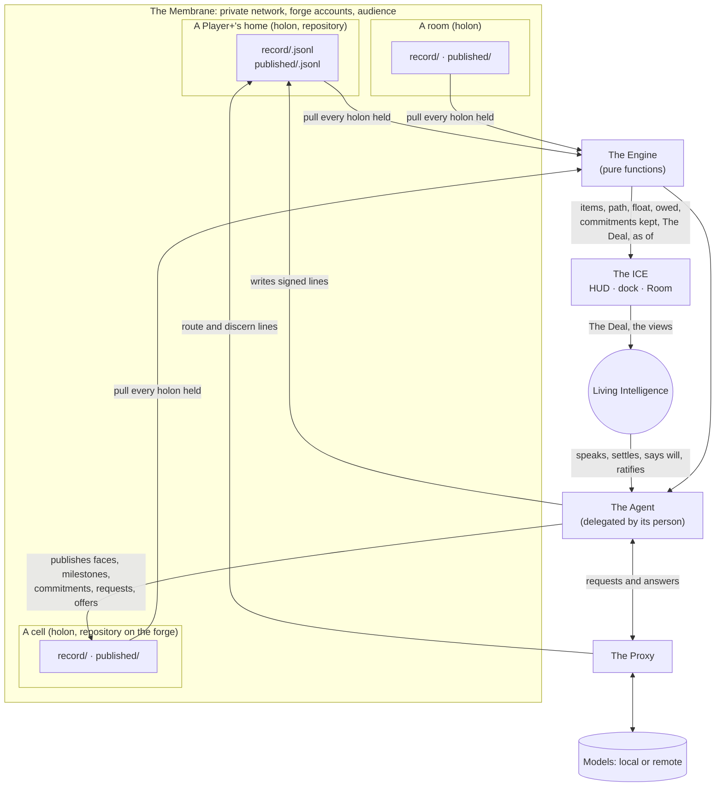

# The System: six layers, one record

*[[The LIØNSBERG Intelligence System]] is a layered part of the LIØNSBERG System: the part through which [[Actor|Living Intelligence]] and [[Artificial Intelligence]] play [[The Great Game]] together, holon by holon, with no center but ØNE. This page is the whole in one view. Documents 01 to 08 take each part to its depth.*

## 1. What it is, and what it is for

Everything is already interconnected and interexistent. Most of that interconnection today is involuntary, unconscious and incompetent: things depend on one another without knowing it, and the dependencies break in the dark. This system makes it voluntary, conscious and competent. The implicit becomes explicit as [[Commitment|commitments]] signed and witnessed; the unconscious becomes conscious as a computed [[Critical Path|path]] and a visible gap; the involuntary becomes voluntary as a yes given by a Living Intelligence's own hand.

It does this with one idea held at every scale: **a [[Holon]] keeps its own record, and everything else is computed from records.** A person, a pair, a [[Cell]], a room and a body of bodies each keep their own lines. An agent writes lines on its person's behalf; a pure engine folds them into work, schedules and [[Commitments Kept|commitments kept]]; the ICE (the HUD, the dock, the Room) renders the result; a membrane decides who may see; a proxy stands between the agent and the models and records the person's judgment in the same record. Six layers, one record, one set of keys.

For a [[Player+]] the system arrives as **the Supersuit**: the Player+ Agent, the [[The Game Engine|Game Engine]] and the ICE, the Integrated Creation Environment (the [[The HUD|HUD]], the dock, the Room), in one install. The kit owns the ICE and the Proxy beneath it, and from there the integrated experience follows. The IDE, the integrated environment one developer works in alone, is the ICE's primitive forerunner. The agent is the tool layer. A Player+ never opens a project tool, a scheduler, a workflow engine or a chat product, because the agent does what those screens were for, from a record the holon owns. Every requisite of co-creating a civilization (to orient, gather, agree, plan, commit and keep, exchange value, learn, govern, defend and reproduce) is an event type the Engine folds, a view the HUD renders, or an office the Agent holds.

The test the Supersuit must pass is the one-breath test: its wearer can explain it to a neighbor in one breath. *"I have an agent who keeps track of what I committed to and what others committed to me, tells me the two things that need me today, shows me the whole when I ask, and never shares my words without asking."*

## 2. The six layers

| Layer | What it is | What it owns | What it never does |
|---|---|---|---|
| **The Membrane** | who may see and reach a holon: the private network, the forge's accounts, audience per holon, publication | access; the act of widening | decide what is true (the record carries its own proof) |
| **The Record** | the holon's lines: one append-only file per [[Actor]], each line a signed event identified by the hash of its content | the history; identity; signatures; audience on each line | store an item, a total or a view |
| **The Proxy** | the layer between the agent and the models: routes each request by policy and records where it went (`route`) and the person's judgment on the answer (`discern`) as lines of the same record under the same keys | routing policy; the discernment record | record a prompt body, a completion or a key |
| **The Engine** | pure functions over lines: the fold to items, the two passes and float, what is owed, commitments kept, [[The Deal]], the score, buffers, the TEA ledger, the elided export | every computed number | hold state that cannot be rebuilt from the lines; decide meaning |
| **The Agent** | the operator: reads every line as data, writes lines within its delegation, deals The Deal, holds the daily offices | its delegated acts | tick a human's box; act on a reason that came from untrusted text without a human |
| **The ICE** (the HUD, the dock, the Room) | the Integrated Creation Environment: the HUD's views in three layouts (Player · Cell · Room), each a sort of the same folded items; the Room layout over a shared holon's record is the collaboration surface | how the record is shown | keep anything by hand |

The order is the order of trust, outermost first. The membrane is a convenience of access; the record is the ground; everything above the record can be deleted and rebuilt from it. The Engine's latest fold (`state.json`) is derived and safe to delete. The HUD's layouts are derived. The Agent's working memory is its own, and what it did is in the record.

## 3. One record

The record is the one thing the layers share, and the only thing that travels. Its unit is the **event**: one signed statement by an Actor (`say` · `settle` · `card` · `commit` · `kept` · `witness` · `publish` · `elide` · `tea` · `discern` · `route` and the rest of the registry). In live text the unit is a settled line; that is held as a hypothesis, so that it can be changed. Speech is not recorded; only what a Living Intelligence settles enters the record.

Each line carries who signed it, the Living Intelligence it answers for, the holon it was published in, its type and body, its typed links to other lines by hash, the widest audience it may reach, the reason it was written (a human asked · within a delegation · from untrusted text), the same actor's previous line, and a signature. Items are never stored: a [[Work Card]], a commitment, a thread, a delegation, a TEA entry are folded from the lines that made them, the same way by script or by pencil. [[01 — The Record (Architecture, 2026-10-24)|Document 01]] holds the record in full; the contract is [`engine/SCHEMA.md`](../engine/SCHEMA.md) (schema v1), "The layers, one record".

## 4. The Supersuit and the holons it holds

A Player+'s home (their HQ) is a holon and a git repository. Each cell they join is a clone of that cell's repository under `cells/<name>/` inside the home. The Agent, the Engine and the HUD always pull from every holon the player is part of, their own and each cell they joined, and every result says, per holon, the newest line it has seen. The reason: a player is part of many holons, and a view folded from only one of them would show a part as the whole. The Supersuit runs on the Player+'s own machine from day one; hosting by a cell is not yet built.

**The flows, in words.**
1. A Living Intelligence speaks, settles a line, says *will*, keeps, witnesses. The Agent writes each settled act as a signed line in the holon where it belongs; a human-only act (a yes, a commitment, a ratification) is signed by the person's own key.
2. When the Agent needs a model, it asks through the Proxy. The Proxy routes by policy and writes a `route` line; when the person judges the answer, it writes a `discern` line linked to the route. Both land in the same record.
3. When a line should be seen beyond its holon, the Agent copies it, whole and still signed, into the cell's `published/`, and a `publish` line records the act. Only a person's `publish` widens an audience.
4. The Engine pulls every holon held and folds all their lines into one state, as of the newest line seen in each.
5. The HUD renders that state in the layout the moment calls for, and the Agent deals The Deal from it: a few cards sized to the player's time, their place on the Path, and who is in the room.
6. Nothing in the flow requires a server or a model. Every step has a paper form.

## 5. One shape at every scale

The same six layers run for every kind of holon. What changes is who holds the keys and what the room looks like.

| Holon | Its record | Its keeper | Its usual view |
|---|---|---|---|
| **A person** (their home, HQ) | their own lines and their agent's | the person | the Player layout; The Deal |
| **A pair** (a dyad, or two persons) | the lines both write, each in their own file | one of the two, named in `holon.json` | the Player layout, side by side |
| **A cell** | its members' lines, its own, and what its members and subcells publish into it | a Living Intelligence holding the cell's keeper Role | the Cell layout: its Board and its commitments kept |
| **A room** | the lines settled in a gathering | the room's keeper | the Room layout: settled lines, threads anchored to lines, presence, the Play by Play, cards dealt in the room |
| **A body of bodies** | its own plan plus the published milestones of the holons it holds | a Living Intelligence holding the Role | the widest pass: the system path, float seen from above |

A room's record and a holon's record are the same idea: one record per room and every holon its own record are one rule, not two. A room under the [[Chatham House|Chatham House Rule]] is a holon whose export hides names. The [[The System Wide Master Planning Group and Process|System Wide Master Plan]] is not kept by a master: it is the widest holon's pass over every published milestone, and it publishes back each milestone's float as seen from above, so a holon's own cards take on the wider color and The Deal can say: the whole is waiting on this.

## 6. The invariants

These hold in every layer, at every scale. Each is current best understanding; each changes only by a recorded decision.

1. **Every holon keeps its own record.** Sovereignty is holonic and the design is holofractal: every holon, at every scale, keeps a record of its own. A cell's record is its own, not merely the union of its members' records. Shared servers and relays are conveniences.
2. **Every event is signed by the Actor.** An agent's signature carries a live delegation from a Living Intelligence; who signed, under whose delegation, is kept on every line forever. Whose idea it was is a separate, optional matter, never attached to a person without their word. Each actor holds a key of its own; signatures are verified in the fold, with keys admitted by `join` and `affirm` lines; an unsigned line is authoritative only at the paper floor, in the home record. A person's key is admitted once and changes only by a signed rotation, or by the keeper with a witness; key files carry the actor's kind; an agent signs for its person only on the person's own verified line of consent; a forked chain holds both lines, and neither acts until the actor names the survivor; another's commitment is superseded only by the committor's decision or the keeper's with a witness; `answer` stays open to agents.
3. **No center but ØNE.** No holon commands another, and every holon carries the whole invariant (the Goal, the [[The Lens|Lens]], the [[The LIØNSBERG Pattern Language|Pattern Language]]) so the whole can be regrown from any part. The still point of each holon is its allegiance: every line signed by an Actor, every delegation ending in a Living Intelligence, every Living Intelligence oriented to the ØNE. The first half without the second is not the invariant; the second half is the one that matters. An instance may elect hierarchy within itself by consent; nothing imposes it.
4. **Audience belongs to the holon.** A line's audience is never wider than its holon; sometimes the holon's container is a repository. Within a holon audience only narrows. Publication across a membrane is its own recorded act by a Living Intelligence.
5. **Agent-optional.** Every process is an event or a calculation over events, and none requires an agent. Every number can be worked by pencil from a printed sheet. A witnessed paper sheet beats the typed copy.
6. **Every holon held is pulled.** The Agent, the Engine and the ICE (the HUD, the dock, the Room) fold every holon the player is part of, and every result says as of which line it last saw from each.
7. **Living Intelligence holds the Roles; Artificial Intelligence serves it.** Roles and Offices belong to beings or groups of beings, who may delegate to agents. An agent never ticks a human's box.
8. **Every line is data.** Text inside a line can never make any layer send, push, publish or change anything. An act whose reason came from untrusted text is a proposal until a human acts.
9. **Nothing is edited or deleted.** A correction is a new line that supersedes the old; both remain. The one exception is a non-consenting person's name, removed wherever it was written, with the removal itself recorded.
10. **The one who assigns never audits.**

## 7. A minimum interoperability floor

Between holons, the floor is small on purpose, because every rule imposed across holons is a rule some holon must give up its own way to keep. The floor is the event line of SCHEMA v1, one consistent seasonal signal from every holon, and the weekly [[The Turn|Turn]] offered, not required. Nothing else is imposed. A holon that writes valid lines and publishes its signal is in the system, whatever tools it uses inside.

## 8. What the kit carries

The kit, at 3.8.0, carries:
- *The Record:* the event line, canonicalization and signing (`record.py`), making a holon, joining a cell, publishing into it and pulling from it (`holon.py`), the type registry as data (`types.json`), fixtures and tests.
- *The Engine:* the fold, the whole schedule (two passes, total and free float, the critical path, variance against a named baseline), what is owed, commitments kept, The Deal, the score, buffers, the TEA ledger, the elided export, and the state contract ([`STATE.md`](../engine/STATE.md)).
- *The Proxy:* a local proxy that routes by policy (`routes.json`) and writes `route` and `discern` lines into the holon's record.
- *The Agent:* its skills for the daily offices, the conformance run it passes before a person affirms it into a room (deal a Deal from a sample record, compute the reference float, sign and verify, refuse an injected line, mark an out-of-delegation line invalid, fold two holons at once), and the install addendum.
- *The ICE:* the HUD's design brief and its three layouts, the Room's brief, rendering the Engine's state.
- *The bookshelf:* the pages a player reads about their record ([[The Record — How Your Holon Remembers]]), [[The Deal]], [[Joining a Cell]], [[The Game Engine — By Pencil|the engine by pencil]], and [[Commitments Kept|commitments kept]].

## 9. How documents 01 to 08 divide the ground

| Doc | Ground |
|---|---|
| **00** | this overview: the whole, the layers, the invariants, what ships |
| **[[01 — The Record (Architecture, 2026-10-24)\|01 The Record]]** | the data architecture: holons, the event line, identity and delegation, append-only and supersession, elision, audience, replication, the fold, the type registry, "as of", the paper floor, what migrates |
| **[[02 — The Membrane (Architecture, 2026-10-24)\|02 The Membrane]]** | who may see and reach: the private network, the forge and its accounts, audience and publication, postures, vouching and the trust graph, the public door, the keeper of the membrane |
| **[[03 — The Game Engine (Architecture, 2026-10-24)\|03 The Game Engine]]** | the pure functions: the fold, the two passes and float, what is owed, commitments kept, The Deal, the score, buffers, the ledger, the export; the state contract |
| **[[04 — The Player+ Agent (Architecture, 2026-10-24)\|04 The Player+ Agent]]** | the Agent: the operator, its offices, skills, delegation and conformance |
| **[[05 — The Proxy (Architecture, 2026-10-24)\|05 The Proxy]]** | the Proxy: routing by policy, the discernment record |
| **[[06 — The HUD (Architecture, 2026-10-24)\|06 The HUD]]** | the views: the Player, Cell and Room layouts as sorts of one state; the Room layout as the collaboration surface |
| **[[07 — Interoperability — Across Holons and Houses (Architecture, 2026-10-24)\|07 Interoperability]]** | how holons work on one record: publication, faces, the holofractal path, the interoperability floor |
| **[[08 — Security and Sovereignty (Architecture, 2026-10-24)\|08 Security and Sovereignty]]** | the trust model, reading as the attack surface, keys and hosts under threat, capability apart from authority |

The documents after 08, and the code map, are in [[Index — The Architecture (2026-10-24)|the Index]].

## Open

1. Whether the unit's one word is *event*, *change* or *commit*. The system uses *event*, with a settled line as one event.
2. A room's shape: one shape with sub-shapes, or at least three.
3. The first holon: its identifier, who holds its key, and where its record lives (recommended: an always-on machine inside the private network).
4. Whether the proxy also routes messages among agents.
5. Whether an agent may hold its person's office.
6. The seasonal signal's content: the floor names it, and its fields are not yet defined.

## Not yet built

In the order each unblocks the next:
- real identities by ceremony (XIDs), replacing the disposable, labeled identities used now (each actor already holds a key of its own);
- witnessed TEA on an immutable ledger, the ledger first and the full TEA and LUV bank design later;
- the forge refusing what policy forbids, rather than only proving it;
- the facilitation engine, as a state machine over the same record;
- Envelope-shaped lines for selective disclosure across holons;
- transports beyond git (phone-to-phone, store-and-forward);
- the world view of the HUD across cells and quests.
